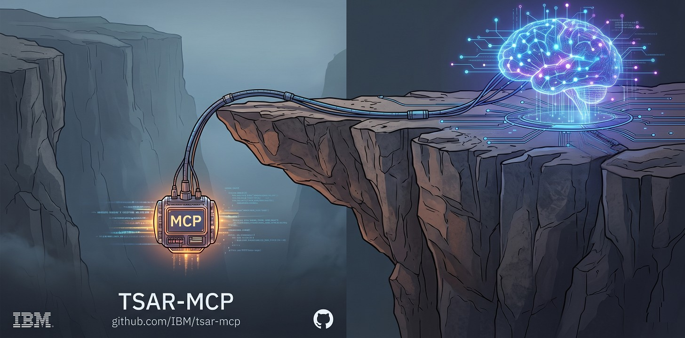

<p align="center">
  
</p>

# TSAR-MCP: Zero-Dependency C/C++ SDK for Edge AI

TSAR-MCP (Tools Slightly Above the Runtime) is a zero-dependency C/C++ toolkit for writing Model Context Protocol servers as native executables: one source file per tool, compiled directly to bare metal. An MCP server lets an AI assistant *do* things instead of only talking about them — read a file, check a process, query a system, run a command.

No Python. No Node.js. No package manager, no runtime to install — and no third-party libraries either: the JSON parser, the protocol engine, and the runtime are all clean-room implementations. It runs where your systems already run, including **AIX** and **IBM i (PASE)**, reached over nothing but `ssh`.

TSAR-MCP opts for local `stdio` instead of web-centric transports. TSAR-MCP servers expose no inbound network ports — no TLS stack to manage, no open attack surface to monitor. Remote access is up to you via `ssh` or a proxy. While your tools can connect to whatever databases or sockets their jobs require, the framework’s built-in outbound features (spawning a local ACP agent or calling an external AI via `cURL`) remain strictly dormant until configured.

That design makes it a practical fit for edge systems, legacy enterprise environments, air-gapped hosts, and any deployment where runtime bloat or exposed network ports are a liability.

Because the framework targets standard OS primitives rather than a heavy runtime, it builds and runs across a wide platform range — from modern Linux and Windows to enterprise IBM systems.

## Getting Started

### 💡 The "Aha!" Moment: Giving AI Hands

An MCP server gives an LLM a controlled way to act outside the chat window. Instead of only generating text, the model can call real tools: read a file, inspect a system, query a service, or trigger local logic.

That may sound complicated in native C or C++, but TSAR-MCP keeps the hard parts in the framework. The transport, JSON-RPC handling, parsing, and response shaping are already built in. You focus on the tool behavior.

**Why C (well... C-style C++) and why is it easy?**
Because the framework already handles the protocol engine, building a new MCP tool usually comes down to filling in a small set of native hooks inside one `.cpp` file. Modern LLMs are surprisingly effective at generating that glue code when you give them the aspect guide.

**Build your own custom MCP Server in 4 steps:**

1. **Get a compiler:** Use `g++` (available natively on Linux) or Visual Studio Community Edition (free on Windows). On AIX / IBM i (PASE), use IBM XL C/C++ (`xlC`).
2. **Get Git:** Download from [git-scm.com](https://git-scm.com) or use your package manager (e.g., `sudo apt install git`).
3. **Clone the repository:** Pull the TSAR-MCP SDK to your local machine.
   ```bash
   git clone https://github.com/IBM/tsar-mcp.git
   ```
4. **Let the AI write the code:** Open your favorite LLM (Claude, ChatGPT, Gemini), attach the **[`mcp/doc/MCPServer_AspectGuide.md`](./mcp/doc/MCPServer_AspectGuide.md)** file, and prompt it with what you want:
   > *"Please read this guide and write me a new MCP aspect to read a specified number of lines from any text file and return it to the client."*

The LLM will seamlessly read the architectural rules and generate the exact `.cpp` file you need. Drop it into the directory, run `make`, and your AI now has a brand new set of hands.

---

### 🔌 Wiring it to your AI Client

Once you have compiled your MCP server, the last step is to register it with an AI client such as Claude Desktop or VSCode. Because TSAR-MCP uses a `stdio` transport model, the same server can run locally, through an SSH tunnel, or behind a proxy without introducing a heavyweight middleware layer.

Read the **[MCPServer Wiring & Transport Guide](./mcp/doc/MCPServer_WiringGuide.md)** to see how to configure your LLM for local, OpenSSH, or PuTTY/Plink connections.

---

### Building the MCP SDK Manually

The core of this SDK is designed around filling in a handful of C functions (with C or C++). You build new AI capabilities by creating an **aspect**: a focused `.cpp` file that defines a tool's name, parameters, and execution logic while plugging into the native MCP engine.

The framework handles the rest: JSON-RPC parsing, request dispatch, response shaping, prompt support, memory management, and process life-cycle.

To learn how to quickly scaffold, build, and test your own custom tools by hand, please read the **[MCPServer Aspect Guide](./mcp/doc/MCPServer_AspectGuide.md)**.

Navigate to the `mcp/` directory. The SDK uses an out-of-source build system, placing compiled binaries into the `build/Release` or `build/Debug` directories.

**Linux (GNU Make):**
```bash
cd mcp
make                 # Builds all aspects (Release mode)
make CFG=Debug       # Builds all aspects (Debug mode)
make helloWorld      # Builds only the helloWorld aspect
make cleanall        # Removes the entire build directory
```

**Windows**

```bash
cd mcp
nmake -f Makefile.nmake                 # Builds all aspects (Release mode)
nmake -f Makefile.nmake CFG=Debug       # Builds all aspects (Debug mode)
nmake -f Makefile.nmake helloWorld      # Builds only the helloWorld aspect
nmake -f Makefile.nmake cleanall        # Removes the entire build directory
```

**AIX / IBM i (native `make` + IBM XL C/C++, 64-bit)**

```bash
cd mcp
make -f Makefile.aix                    # Builds all aspects (Release mode)
make -f Makefile.aix CFG=Debug          # Builds all aspects (Debug mode)
make -f Makefile.aix helloWorld         # Builds only the helloWorld aspect
make -f Makefile.aix cleanall           # Removes the entire build directory
```

## Core Architecture

TSAR-MCP is built around a simple native execution path: an MCP client sends JSON-RPC over `stdio`, the framework parses and validates it natively, dispatches the request into your aspect, and returns a well-formed response back to the client. There is no Python interpreter, no Node.js runtime, and no external protocol layer sitting between your tool logic and the operating system.

* **Stray Output Can't Break It (Isolated JSON Transport):** The AI talks to your server over `stdout`, so a single stray `printf` from some library you linked would normally corrupt the conversation and drop the connection. TSAR-MCP moves the real `stdout` out of the way and keeps the protocol on a private channel, so noisy third-party code cannot interfere.
* **Works With Old and New Clients (Protocol Compatibility):** MCP has several published versions and clients are scattered across them. The server negotiates whichever one the client speaks, defaulting to the stable `2025-11-25` specification; a compile-time flag opens up the newer stateless `2026-07-28` protocol, which is still a Release Candidate.
* **Slow Tools Don't Block (`MCPAsyncWork`):** A tool that takes thirty seconds would normally stall the entire server. This layer runs it on a worker thread, keeps the message loop answering, and lets the AI cancel it mid-flight. See the **[MCPServer Advanced Patterns Guide](./mcp/doc/MCPServer_AdvancedPatterns.md)**.
* **Talking to Other AI Tools (JSON-RPC 2.0 Client):** Normally an MCP server only answers the AI client. This layer lets it start another program and hold a two-way conversation with it — so one TSAR-MCP server can use *other* MCP servers as tools, or drive a local coding agent over ACP. (`XCPClient` moves the lines, `RPCClient` matches replies to requests, `MCPClient` and `ACPClient` speak the protocols.) Sampling below is the first thing built on this, not the reason for it.
* **Asking the AI a Question (Blocking Sampling):** Usually the AI calls your tool; sometimes your tool needs to ask the AI — *"is this spelled correctly?"*, *"summarize this log"*. `MCPSyncSamplerEx` makes that a single function call that waits for its answer, with no callbacks to wire up, and finds a model wherever one is available: the connected client's own, a local agent, or an external provider. Only the external one leaves your machine, which is why it is tried last.
* **Bad Input Never Reaches Your Code (Native BNF Parsing):** Every incoming message is checked against a formal grammar before it is dispatched, so your tool is never handed malformed JSON to defend against.
* **One File Per Tool (Single-File Aspect Model):** A new capability is one `.cpp` file filling in a handful of functions. The framework does the handshake, the dispatch, and the response shaping.
* **Prompts That Work Everywhere (Prompt Polyfill):** MCP "prompts" are saved instructions a user can invoke by name, but many clients still do not support them. TSAR-MCP also offers them as ordinary tools — which every client supports — so your prompts work either way (`listPrompts`, `getPrompt`).
* **The Runtime Predates the Protocol (`CommonC`):** "We wrote our own JSON parser" is usually a warning sign. This one is a grammar handed to an LR parser engine written in 1998 — the same engine that was chewing through high-frequency SQL in 2012. The threading layer dates to 2001. None of it was written for MCP; MCP is just the newest thing standing on it.

## Included Examples & Roadmap

This repository includes the core SDK framework alongside target-specific MCP server implementations and standalone utilities to demonstrate the extensibility of the architecture:

* **WordArt Generator ([`wordArt`](./mcp/servers/wordArt/MCPServer_wordArt.cpp)):** Demonstrates **bi-directional LLM-code integration** (MCP Sampling / MCP Multi-Round-Trip-Request). Rather than relying on native C string manipulation, this aspect dynamically prompts the client's LLM (`sampling/createMessage`) to generate styled ASCII art—showcasing the simplicity by which TSAR-MCP bridges the absolute deterministic safety of a native C runtime with the dynamic cognitive reasoning of modern AI.

* **Universal Sampling ([`spellCheck`](./mcp/servers/spellCheck/MCPServer_spellCheck.cpp)):** Demonstrates `MCPSyncSamplerEx`, the hybrid blocking sampler. MCP sampling normally arrives as an asynchronous round trip the aspect must correlate and resume from a handler. `MCPSyncSamplerEx` turns it into a **blocking call on a worker thread**, so an aspect needing several completions issues them in sequence as ordinary straight-line code rather than a chain of callbacks. That same call is client-independent: where `wordArt` uses MCP sampling as the specification defines it, `spellCheck` works even against a client that does not implement sampling at all — falling through to a local agent over ACP, and failing that to an external AI provider. Cancellation reaches all four paths.

* **TSAR-MCP Markdown Viewer ([`MarkdownViewer.html`](./tools/MarkdownViewer/MarkdownViewer.html)):** A self-contained, single-file HTML Markdown viewer. Running entirely in the browser to keep your documents private, it provides syntax highlighting, mathematical KaTeX rendering, a floating Table of Contents, and "save to HTML" and printing functionality. It is perfect for reading the architectural documents in this repository. **[▶ Open the live viewer](https://ibm.github.io/tsar-mcp/tools/MarkdownViewer/MarkdownViewer.html)**

* **REST API Execution ([`cURLExample`](./examples/cURLExample/cURLExample.cpp)):** A standalone utility demonstrating `cURLRunner`, a generic, cancelable REST transport built directly into the `CommonC` foundation. It parses the resulting payload using the native `JSONParser` to facilitate high-performance external API communication without tying into the MCP protocol loop.

* **Hello World & Port Scan ([`helloWorld`](./mcp/servers/helloWorld/MCPServer_helloWorld.cpp), [`portScan`](./mcp/servers/portScan/MCPServer_portScan.cpp)):** Basic implementations that demonstrate how to bind standard I/O to the native JSON-RPC parsing framework, and how to interact sequentially with local network sockets.

* **Asynchronous Threading ([`setReminder`](./mcp/servers/setReminder/MCPServer_setReminder.cpp)):** Demonstrates the framework's native non-blocking threading model. By spawning a background timer that triggers delayed server-to-client notifications, this aspect proves how easily the C-runtime framework can handle long-running asynchronous tasks without freezing the AI client. This is the core deferred-response pattern (your own thread plus `PostNotifyAction`); see `netstat` below for the structured `MCPAsyncWork` framework.

* **Asynchronous System Execution & Cancellation ([`netstat`](./mcp/servers/netstat/MCPServer_netstat.cpp)):** Demonstrates `MCPAsyncWork` by executing long-running system commands (`netstat` on Linux/AIX, PowerShell on Windows) on worker threads. Illustrates real-world process cancellation by binding `AbortWork()` to `pabortNT()` to terminate slow DNS resolutions when receiving a `notifications/cancelled` notification.

**Enterprise Roadmap:** Because the framework compiles to a highly efficient native binary, future milestones will introduce heavy-duty enterprise aspects. This includes modules like **SAP Control (`sapControl`)**, which will allow LLMs to monitor processes and edit profiles across an SAP landscape using native commands, entirely eliminating the need for heavy SOAP gateways or third-party agents.

## 🗺️ Exploring this Repository (Learning Path)

This repository is structured as a chronological masterclass in building zero-dependency C-runtime based MCP servers. Because the `main` branch contains advanced asynchronous and threading models, **we highly recommend exploring our milestone tags chronologically to understand the core architecture:**

1. **Tag:** `mcp/teaching/v1.0.0` - The zero-dependency sequential MCP baseline.
2. **Tag:** `mcp/aspects/v1.1.0` - Introduces the simple, production-ready aspect model. **Check out this teaching version to understand the essence of how aspects are built and wired.**
3. **Tag:** `mcp/async/v2.0.0` - The advanced threaded and asynchronous runtime framework.
4. **Tag:** `mcp/enterprise_io/v2.1.0` - Isolated I/O stream and JSON protocol safety.
5. **Tag:** `mcp/agentic_prompts/v2.2.0` - Prompts as agentic services via `listPrompts` and `getPrompt` tools.
6. **Tag:** `mcp/stateless_rc/v2.3.0` - Introduces 2026-07-28 stateless protocol RC alongside process control (`popenNT`), generic REST utilities (`cURLRunner`), and custom lifecycle hooks (`NO_MAIN_MCP`).
7. **Tag:** `mcp/aix_ibmi_port/v2.4.0` - Enterprise Platform Port: Adds native 64-bit IBM XL C/C++ (`xlC`) support for AIX and IBM i (PASE).
8. **Tag:** `mcp/async_core/v2.5.0` - Introduces `MCPAsyncWork` for object-oriented background work-item dispatch and thread management.
9. **Current (`main`):** JSON-RPC 2.0 Client Transport, ACP Agent Bridge, and Universal Sync Sampling Support. Not yet tagged — will become `mcp/sampling_client-bridge/v2.6.0`.

Please see **[ARCHITECTURE_MILESTONES.md](./ARCHITECTURE_MILESTONES.md)** for detailed instructions on how to check out these historical baselines.

## The Foundation and The Future

> *This SDK has a story. When the architect asked an AI assistant to help build a helloWorld MCP server in C, the first response was: "That will be somewhat difficult — there are easier ways." The follow-up: "Why is it difficult??" The AI explained: JSON parsing, raw I/O, strict JSON-RPC back to the client. The reply was: "One moment, let me show you something" — and a battle-tested BNF JSON parser built a decade earlier for high-frequency SQL processing was attached. The AI read the header and immediately reversed course: "Oh, well then it's not so difficult." TSAR-MCP is what came next.*

This repository is built upon the **TSAR** C-runtime — *"Tools Slightly Above the Runtime"* — a foundation whose LR parser engine dates to 1998 and whose threading layer to 2001, hardened through a decade of high-frequency SQL processing (included here as `QueryTool`). By leveraging this battle-tested bedrock, the modern MCP AI aspects inherit enterprise-grade memory management, native BNF parsing engines, and steady performance, while leaving the framework architecture completely open for future bare-metal utilities.

### 🏛️ Legacy Origins: The SourceForge Query Tool
For those interested in exploring the original 2012 architecture before the MCP AI integrations, the pristine initial import from the legacy SourceForge repository has been preserved in the project history. 

See **[ARCHITECTURE_MILESTONES.md](./ARCHITECTURE_MILESTONES.md)** (Tag: `db/querytool/v1.0.0`).

## License & Authorship

Copyright (c) 2026 International Business Machines
Architected and Authored by Eric Kass
Licensed under the [MIT License](./LICENSE).
